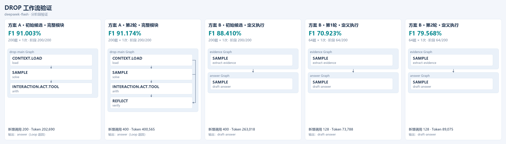

# 自动探索

## 运行

先按 [本地安装](../LOCAL_SETUP.md) 准备依赖、数据和 `.env`。

| 命令 | 入口 |
| --- | --- |
| `npm run search:drop` | 原节点快照流程，默认优化器为 `baseline`。 |
| `npm run experiment:drop:a` | A：模型生成 JavaScript 模块，从空历史开始，默认 64 题。 |
| `npm run experiment:drop` | B：模型生成 Graph/Loop JSON 定义，从空历史开始，默认 64 题。 |
| `npm run experiment:user-prompts` | 读取 [中文提示词](../prompts/README.md)，依次运行 A/B，默认 200 题。 |

中文入口可指定方案：

```powershell
powershell -NoProfile -File scripts/run-user-prompts.ps1 -Representation A
```

流程：评估初始候选 → 模型根据反馈修改 → 分阶段评测 → 保留最佳候选。阶段为 16/32/64/128/200 题，每题一次；后续阶段只补新题。明显退步时提前淘汰，最终选优只比较完成全部题目的候选。

模型自行修改提示词、节点和控制逻辑。程序校验接口、提供运行反馈并控制预算。到达目标、轮次或预算上限时结束；SDK 重试和在途请求可能造成少量超额。

原 CLI 可通过 `DITTO_OPTIMIZER_PROFILE` 选择 `prompt-v2`（修改指导）或 `feedback-v3`（同时增加反馈）。

## 代码

| 文件（scripts/ 下） | 职责 |
| --- | --- |
| `generated-search-prompt.mjs` | 优化指导 |
| `generated-workflow-a.mjs` / `generated-workflow-b.mjs` | A 加载器与 B 执行器 |
| `generated-infer-contract.mjs` | Ditto 0.1.1 原生操作的输入校验 |
| `generated-search-feedback.mjs` | 公开案例、同题变化及部分节点输入输出 |
| `generated-small-batch-search.mjs` | 生成、评测、预算和选优 |
| `render-workflow-report.py` | 流程与得分图 |

`src/ditto/runtime.ts` 在实际模型调用前检查预算；`src/benchmark/drop.ts` 提供验证子集入口。反馈包含公开题面、预测和得分，长记录会截断并标记。A 的 VM 用于代码校验，进程隔离需另行配置。

## 结果文件

- `manifest.json`：配置、状态和总消耗。
- `proposals/`：优化器请求及原始回复。
- `candidates/`：候选代码或定义。
- `evaluations/`：逐题得分、阶段结果和节点记录。
- `best/`：完整规模最佳候选。
- `workflow-report.png`：[流程图](workflow-report.md)。

## 中文提示词实验

以下为 200 道验证题上的搜索成绩，初始结构取自先前模型候选。独立测试待运行。



| 方案 | 初始 200 题 F1 | 新候选 |
| --- | ---: | --- |
| A | 91.003% | 第1轮依赖缺失；模型修复后第2轮 200 题 91.174%，加入 REFLECT，评测调用由 200 增至 400。 |
| B | 88.410% | 两轮分别为 70.923%、79.568%（64 题），淘汰后保留初始候选。 |

每题一次。A 消耗 603 请求 / 647,525 tokens，B 消耗 658 请求 / 469,103 tokens。早期英文实验见 [实验记录](expanded-infer-search.md)。
