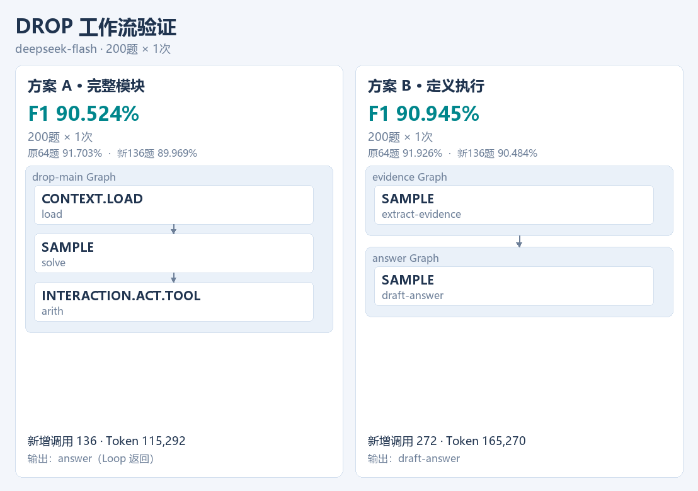
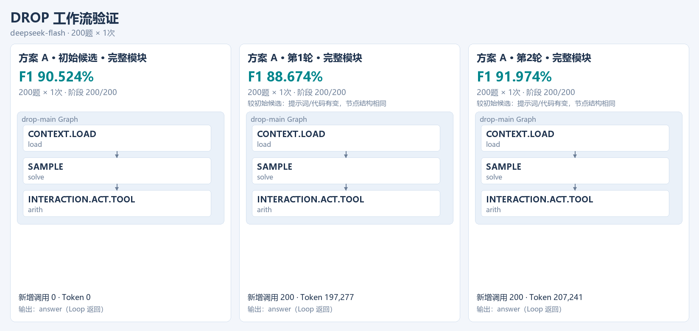
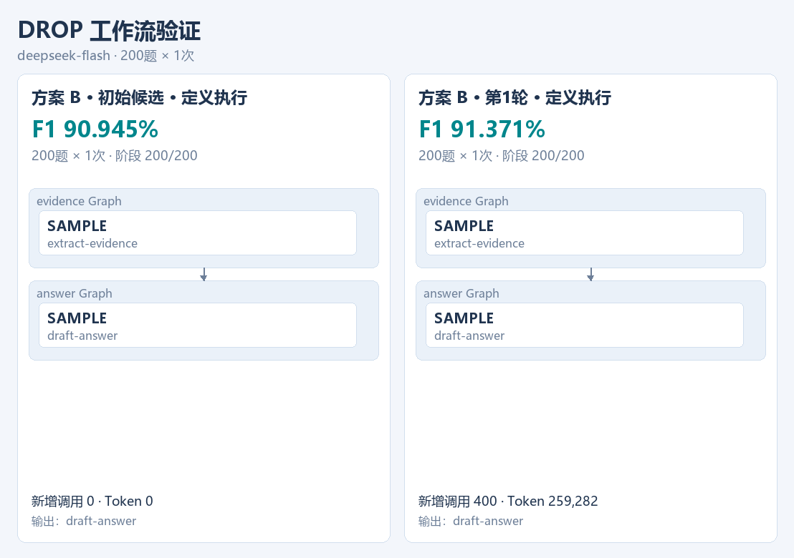
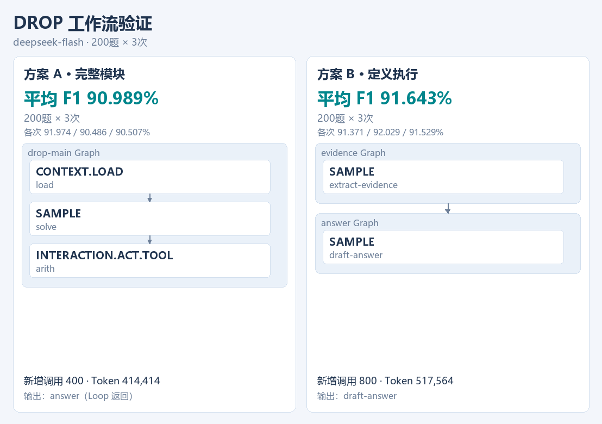

# 200 题实验记录

2026-10-27，使用 `deepseek-flash`，temperature=0，thinking disabled。评测范围为 DROP 的 200 道验证题；独立测试待运行。

## 执行配置

A/B 接入 Ditto 0.1.1 的 TRAJECTORY、DELIBERATE、REFLECT。接口由 `generated-infer-contract.mjs` 校验，模型选择节点并生成工作流。

本轮优化器版本为 `evidence-hypothesis-v3-full-infer`，A 接口版本为 `generated-workflow-a-v3-native-infer-input-shapes-and-trace`，B 为 `generated-b-guide-v4-native-infer`。每路最多两个新候选、750 次请求、150 万 token。

## 从 64 题扩到 200 题

固定旧候选，复用前64题结果，补跑136题。结果保存在原目录的 `expanded-validation/<candidate>/`。

| 旧候选 | 原64题 | 新增136题 | 全200题单次F1 |
| --- | ---: | ---: | ---: |
| A generated-002 | 91.703% | 89.969% | 90.524% |
| B generated-004 | 91.926% | 90.484% | 90.945% |

## 自动搜索

从扩展后的候选继续优化，按 16→32→64→128→200 题逐级评测，每题一次。

A：初始候选 → 第1轮 → 第2轮。

B：初始候选 → 第1轮。

| 新候选 | 200题单次F1 | 相对旧候选 | 同题改善/退步/持平 |
| --- | ---: | ---: | --- |
| A 第1轮 | 88.674% | -1.850个百分点 | 5 / 11 / 184 |
| A 第2轮 | 91.974% | +1.450个百分点 | 6 / 3 / 191 |
| B 第1轮 | 91.371% | +0.426个百分点 | 8 / 5 / 187 |

A 保留 LOAD→SAMPLE→算术工具，修改了答题类型、排名提示、表达式过滤和答案归一化；B 保留两个 SAMPLE，修改了百分比差值和多值问题的提示词。本轮使用的节点类型与初始候选相同。

运行目录：

- `runs/generated-expanded/drop/2026-10-27-native-infer-A`
- `runs/generated-expanded/drop/2026-10-27-native-infer-B`

## 重复评测

固定 A 第2轮和 B 第1轮候选，各补两次评测：

| 优胜候选 | 第1次F1 | 第2次F1 | 第3次F1 | 平均F1 |
| --- | ---: | ---: | ---: | ---: |
| A 第2轮 | 91.974% | 90.486% | 90.507% | 90.989% |
| B 第1轮 | 91.371% | 92.029% | 91.529% | 91.643% |

| 阶段 | 新增请求 | Token |
| --- | ---: | ---: |
| 旧候选扩展 | 408 | 280,562 |
| A 自动搜索 | 402 | 447,522 |
| B 自动搜索 | 401 | 273,590 |
| A 重复评测 | 400 | 414,414 |
| B 重复评测 | 800 | 517,564 |
| 合计 | 2,411 | 1,933,652 |

## 一个具体变化

`drop:7278` 中，A 第1轮和第2轮的 SAMPLE 都返回 `Somali Air-force`，工具都得到 `1/2 - 1/3 = 0.16666666666666669`。第1轮的返回代码用数字覆盖了实体答案，F1 为0；第2轮保留实体答案，F1 为1。两版图结构相同，返回代码不同。

运行方法见 [自动探索](autonomous-workflow-changes.md)，早期结果见 [64题记录](small-batch-search.md)。
